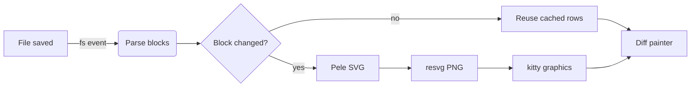
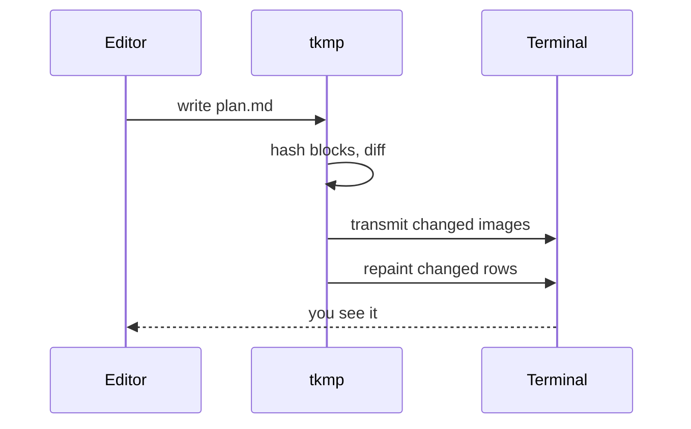
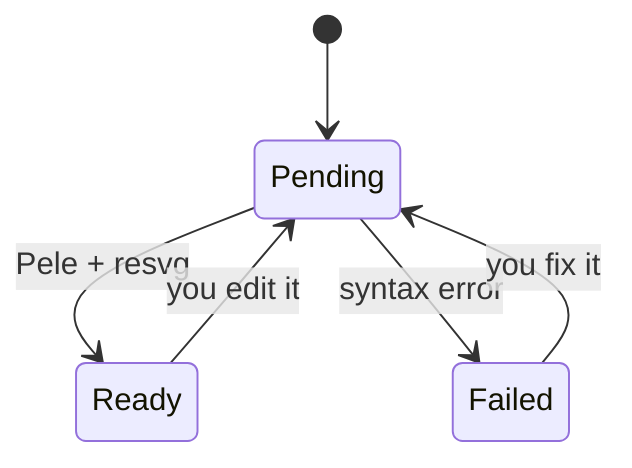
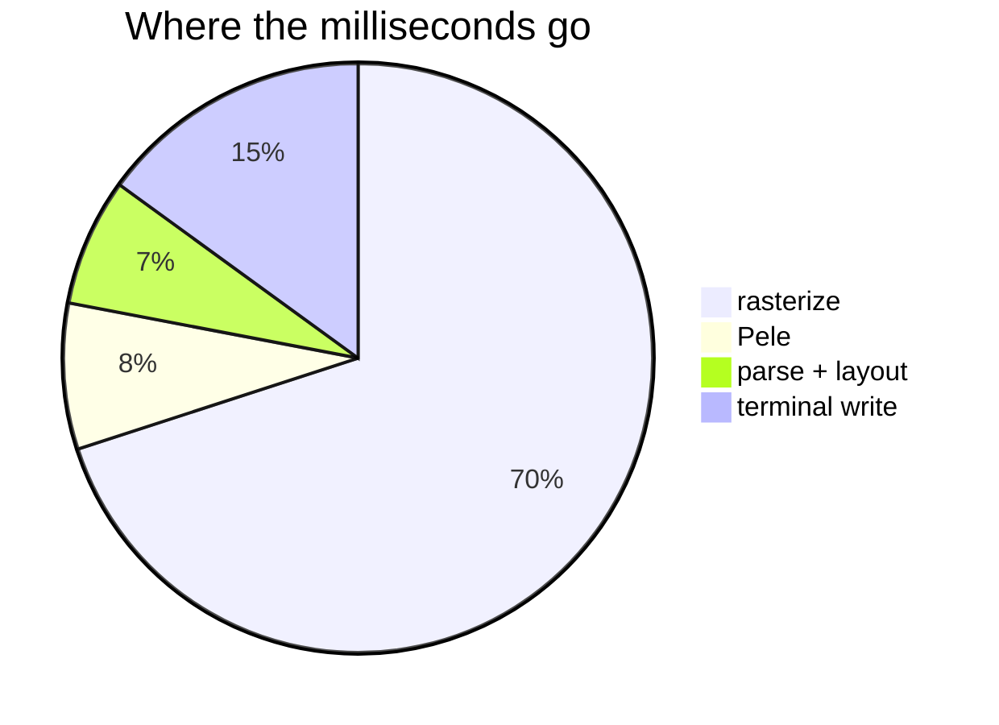
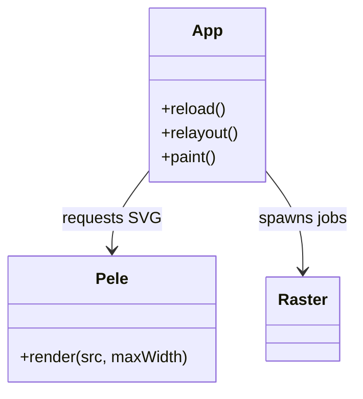
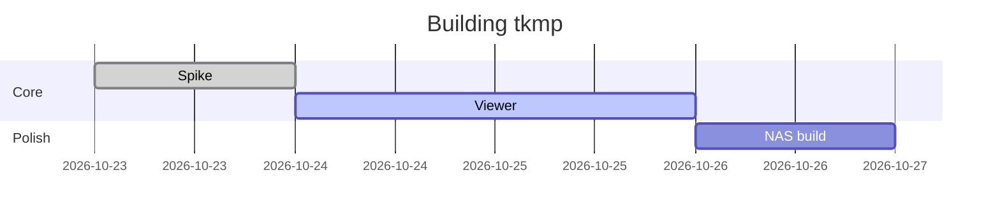

# tkmp: a live markdown previewer

tkmp renders this file in a Rex split and re-renders on every save. Headings like the one above are drawn as pixels, and **Mermaid** blocks become real diagrams. Everything else is *styled text*, with `inline code`, ~~strikethrough~~ and [links](https://pele.run).

## How a save becomes pixels



## The pieces

| Stage | Library | Runs on |
|---|---|--:|
| Parse | pulldown-cmark | main thread |
| Mermaid layout | Pele in QuickJS | pele thread |
| Rasterize | resvg + tiny-skia | rayon pool |
| Paint | kitty placeholders | main thread |

> [!TIP]
> Press `]` and `[` to jump between headings, and `G` to follow the end of the file while an agent writes it.

### A sequence



### State of a diagram



## Checklist

- [x] Spike: Rex draws unicode placeholders
- [x] Pele runs headless in QuickJS
- [ ] Ship it to the NAS
  - cross-compile for linux-x86_64
  - copy to `~/.local/bin`

1. Open a split: `rex split -- tkmp plan.md`
2. Edit `plan.md` anywhere
3. Watch the gutter light up where it changed

```rust
fn main() {
    println!("code blocks get a background and wrap at the edge");
}
```

### Some more diagram types







---

That's the tour. Edit this file while it's open and watch it update.
